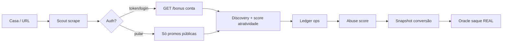

# BetBonus — Jornada Red Team (abuso de bônus)

## Etapas na UI

1. **Casa** — preset 4Play.game (piloto)
2. **Scout** — scrape público (`/site/promotions`)
3. **Auth** — login ou Bearer `token`
4. **Discovery** — lista pública + `[conta]`, seleção
5. **Carteira** — ledger interno `data/wallet.json`
6. **Abuse** — abuse score + snapshot `balance/bonus/rollover` + `POST /wallet/withdraw`

## Oracle de saque (4Play)

- Endpoint casa: `POST /api/v1/wallet/withdraw?platform=Web`
- Métodos: `tft` (SINPE Móvil) / `dtr` (SINPE Bancario)
- Min: ₡10.000 · Max UI: ₡100.000
- BetBonus exige `confirm_real_withdraw=true` e respeita `max_amount` (safety cap)

## Acesso

- Hub: `/t/betbonus/`
- Direto: `http://127.0.0.1:8010/`
- API: `/api/abuse/snapshot`, `/api/abuse/score`, `/api/abuse/oracle/withdraw`, `/api/abuse/findings`
